# raytracer

Trazador de rayos óptico en Python. Propaga luz **exactamente** —resolviendo
la ecuación de cada superficie, sin aproximación paraxial— a través de
sistemas ópticos reales, y mide lo que sale: aberraciones, distorsión,
frente de onda, PSF, formación de imagen.

**Un solo modelo físico —elementos colocados en un medio ambiente— leído por
un motor secuencial y uno no secuencial · 13 paquetes en cadena estricta ·
397 tests contra verdades analíticas · dos objetivos de patente replicados
dígito a dígito · lentes estigmáticas y aplanáticas por superficies de
Descartes, con optimizador de restricciones enchufables y materiales reales**

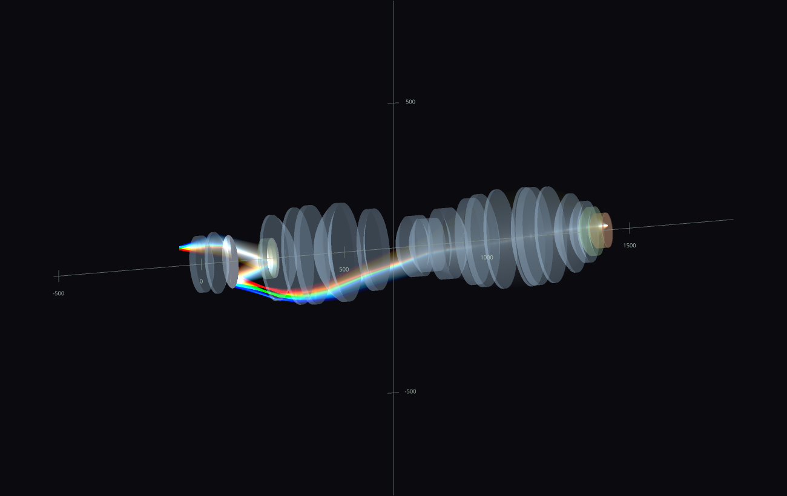

Arriba: el objetivo litográfico DUV de la patente US 7,557,996 —48
superficies, 12 asféricas, NA 1.2 en inmersión— recorrido por tres haces de
distinta longitud de onda. Se separan en el camino catadióptrico plegado y
vuelven a sumarse a blanco en la imagen. Lo dibuja el visor OpenGL, que
acumula los rayos aditivamente en un framebuffer de coma flotante: donde se
superponen miles de rayos la intensidad *suma*, y un tone-mapping
auto-expuesto revela la estructura del haz dentro del rango dinámico.

## Qué hace

Un sistema óptico es **un conjunto de elementos físicos —lentes, espejos,
divisores de haz, prismas, diafragmas, sensores— colocados en el espacio y
sumergidos en un medio ambiente**. Se escribe así, elemento por elemento con
su posición y orientación, o con la notación concisa de siempre (una
composición a lo largo del eje, o una tabla de prescripción) que construye
exactamente lo mismo. Sobre ese único modelo el paquete responde tres
preguntas.

**¿Por dónde va la luz?** Cada rayo se intersecta con cada superficie
resolviendo su ecuación: forma cerrada para las cónicas, Newton desde el
plano del vértice para las demás. La refracción y la reflexión se aplican
en forma vectorial completa, y la reflexión total interna se detecta rayo a
rayo. Qué hace la luz en una frontera no se declara en ninguna parte: se
deduce de los medios a cada lado (que el sistema resuelve a partir de los
elementos) y del recubrimiento de la superficie.

**¿Qué tan bien forma imagen?** Spot diagrams ponderados por área de pupila,
ray fans transversales, distorsión por rayo principal (la convención de
Zemax/OpticStudio), coeficientes de Seidel deducidos del frente de onda
real, expansión de Zernike ANSI/OSA, aberración cromática axial y lateral,
frente de onda por eikonal, PSF escalar e imagen aérea parcialmente
coherente por el método de Abbe.

**¿Cómo se ve?** Dos backends sobre una misma escena: figuras matplotlib
para el análisis, y el visor OpenGL HDR para el trazado. El dibujo es una
lista de ítems neutrales —segmentos de rayo, perfiles de superficie,
cuerpos de lente, sensores, marcadores— y cada backend la consume entera.
Un dibujo 2-D es el corte meridional (plano y-z) del modelo 3-D.

## El modelo: elementos colocados en un medio

```python
import raytracer as rt
from raytracer import elements as el
from raytracer.geometry import surfaces as sf
from raytracer.materials import default_materials

glass = default_materials()

cooke = rt.OpticalSystem(
    name="Cooke triplet",
    ambient=rt.AIR,
    components=[
        el.Lens("L1", front=sf.Sphere(21.25), back=sf.Sphere(-158.65), thickness=2.0,
                material=glass["N-SK16"], semi_diameter=6.5, z=0.0),
        el.Lens("L2", front=sf.Sphere(-20.25), back=sf.Sphere(19.30), thickness=1.0,
                material=glass["F4"], semi_diameter=5.0, z=8.0),
        el.Stop("STO", aperture=4.75, z=9.0, virtual=True),  # en el vértice curvo de L2: un plano de referencia
        el.Lens("L3", front=sf.Sphere(141.25), back=sf.Sphere(-17.285), thickness=2.0,
                material=glass["N-SK16"], semi_diameter=6.5, z=15.0),
        el.Sensor("IMG", z=59.95),
    ],
)
```

Cada elemento acepta su colocación de la misma forma: `pos=(x, y, z)` o
`z=`; `rot=` con ángulos de Euler en grados (intrínsecos x → y′ → z″,
`R = Rx @ Ry @ Rz`), con `(ángulo, eje)` o con una `rt.Rotation`; o
`axis=` / `normal=`, hacia donde apunta su +z local. Los sistemas son
valores: `cooke.rotated(45, (1, 1, 0), about=(10, 0, 5))` devuelve otro.

Lo que se **deduce** del sistema, nunca se declara:

- **los medios a cada lado de cada frontera.** Donde la cara de un elemento
  coincide con la de otro (misma pose, misma superficie), son una sola
  frontera entre dos materiales: un doblete cementado, un líquido de
  inmersión contra una lente;
- **el camino secuencial**, en el orden en que la luz visita las fronteras.
  Se infiere para un sistema coaxial; un sistema plegado o con divisor de
  haz lo declara, con `"BS:reflect"` donde la física ofrece dos ramas.

Una tabla de prescripción se lee como lo que describe. El objetivo DUV de
la patente queda así:

- su lente de CaF₂ recorrida dos veces es **una** lente;
- sus dos espejos son elementos;
- el plano de diafragma que la tabla pone dentro de una lente es un
  diafragma **virtual**;
- el líquido de inmersión es un cuerpo en contacto con la última lente y
  con el sensor.

## Los dos motores

**Secuencial** — cada rayo visita las fronteras del camino en orden, un solo
recorrido determinista, y los N rayos avanzan juntos en numpy con un
`TraceStatus` por rayo (viñeteo, TIR, fallo de intersección, o `BEHIND`:
el camino declarado lo manda a una frontera que ya pasó). Sobre él se
apoyan la capa paraxial, el rayo principal y el muestreo de pupila. La
longitud de onda y el plano objeto son hechos *de uso*: viven en el
trazador, no en el sistema.

```python
from raytracer.io import read_prescription
from raytracer.tracing import FieldPoint, PupilSampling, solve_object_plane, trace_pupil
from raytracer.analysis import spot_data

duv = read_prescription("data/optical_systems/lithography/US7557996_Fig3_Table3_prescription.csv")
tracer = duv.tracer()               # a la longitud de onda del archivo (193.368 nm)
solve_object_plane(tracer)          # recupera el plano objeto imponiendo B = 0

pupil = trace_pupil(tracer, FieldPoint(y=62.0), na_object_sine=0.3,
                    sampling=PupilSampling(kind="rings", radial=12, azimuth=72))
print(spot_data(pupil).rms_radius_um)        # 0.087 µm
```

**No secuencial** — sin orden: cada rayo se prueba contra todas las
fronteras del *mismo* sistema, y en la primera que encuentra se divide en
hijo reflejado y transmitido según su recubrimiento (Fresnel en una
superficie desnuda). Los bordes de lente, las láminas de diafragma y los
sensores absorben; los sensores además registran. Con `split=False` cada
rayo sigue sólo la rama que tomaría el trazado secuencial: el dibujo
limpio.

```python
from raytracer.sources import CollimatedSource
from raytracer.tracing import NonSequentialTracer

beam = CollimatedSource((0, 0, -40), direction=(0, 0, 1), beam_radius=2.0, rays=500, wavelength_um=0.55)
tree = NonSequentialTracer(cooke, split=True).trace(beam)
tree.hits("IMG").power.sum()     # potencia que llega al sensor, descontadas las pérdidas de Fresnel
```

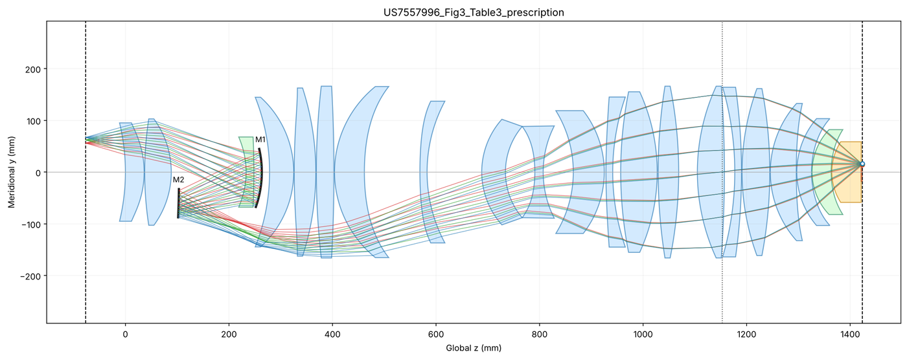

El trazado sigue el camino catadióptrico plegado: los dos espejos (M1, M2)
devuelven el haz sobre sí mismo antes del grupo de inmersión final.

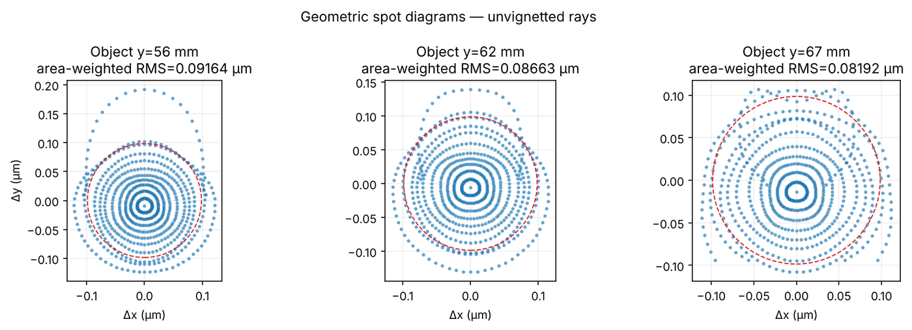

Spots recentrados en el centroide ponderado por área de pupila, con el primer
cero de Airy como referencia: los tres campos quedan por debajo del límite de
difracción.

Y el corte meridional del mismo trazado, con acumulación HDR: 363 rayos
exactos llenando la apertura, terminando sobre el sensor en el plano
imagen.

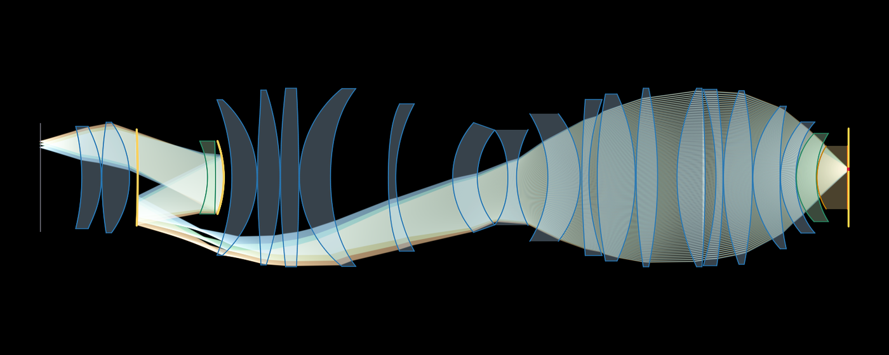

## El mapa objeto → imagen

Un sistema ideal manda cada punto objeto a `magnificación × objeto`. La
distorsión es la desviación del mapa real respecto de esa recta.
`distortion_grid` la mide trazando una malla cuadrada de puntos de campo,
uno por rayo principal —el rayo que pasa por el centro del diafragma, la
referencia estándar, inmune al coma y al viñeteo que arrastran el centroide
de un spot—, y devuelve dónde aterriza cada punto en el plano imagen.

```python
import numpy as np
from raytracer.analysis import distortion_grid
from raytracer.io import read_prescription
from raytracer.tracing import solve_object_plane
from raytracer.viz import plots

tracer = read_prescription("data/optical_systems/photographic/cooke_triplet_prescription.csv").tracer()
conjugate = solve_object_plane(tracer)
half = abs(conjugate.object_z) * np.tan(np.deg2rad(10.0))   # ±10° de semicampo

grid = distortion_grid(tracer, magnification=conjugate.magnification,
                       half_field=half, n=11)

print(grid.valid_fraction)                     # 1.0  -- 121/121 sin viñetear
print(grid.max_distortion_um)                  # 7.564  (µm)
print(grid.max_relative_distortion_percent)    # 0.1567 (% de la altura de imagen)

plots.distortion_grid_figure(grid, exaggeration=25.0)
```

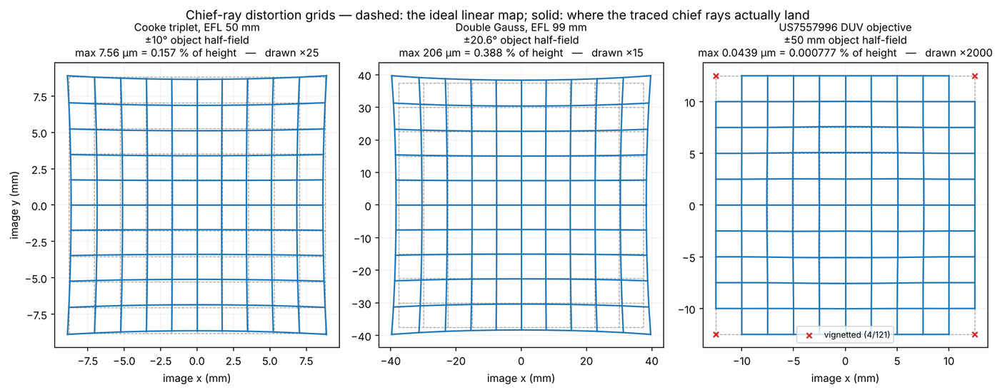

Cada panel superpone dos mallas: la ideal, en gris discontinuo, y la
trazada, en azul. El dial `exaggeration` amplifica la desviación de cada
punto alrededor de su posición ideal, y cada panel usa el suyo: entre el
Doble Gauss y el objetivo DUV hay un factor 4700 en desviación máxima, y un
multiplicador común dejaría dos paneles ilegibles. El título de cada panel
lleva la magnitud verdadera, sin amplificar.

El triplete Cooke y el Doble Gauss dibujan corsé (**pincushion**): la
desviación radial es positiva en todo el campo y crece con él, hasta 7,6 µm
y 206 µm en la esquina — 0,157 % y 0,388 % de la altura de imagen.

El objetivo DUV, a ×2000, muestra el residuo de un diseño ya corregido: la
desviación llega a +43,9 nm hacia r ≈ 5,6 mm (7,8 partes por millón, el
máximo relativo), cruza el cero cerca de r ≈ 11,5 mm y termina en −2,2 nm en
las esquinas del campo. El signo cambia dentro del campo, que es la firma de
una distorsión balanceada en el diseño, y todo ello sobre un campo imagen de
25 mm de diámetro.

Las cuatro esquinas marcadas con una `x` roja son puntos cuyo rayo principal
vieta: la malla llega a 50 mm de semicampo objeto, y sus esquinas quedan a
50·√2 = 70,7 mm, más allá del radio útil de ~68 mm del diseño. Esos puntos
quedan como `NaN`, rompen la línea que atravesarían y quedan contados en
`grid.valid_fraction`.

Para la curva clásica de distorsión contra campo, `chief_ray_distortion`
hace el barrido 1-D con un solo rayo principal por punto, en mm de altura
objeto o en grados de campo.

## Superficies

Una superficie es **geometría y sólo geometría**: la gráfica `z = s(x, y)`
en su propio marco, vértice en el origen y eje en +z. Dónde está la pone la
pose del elemento que la lleva. Qué hace la luz allí lo deciden los medios
y el recubrimiento. Declarar `s` y su gradiente basta: la intersección
(Newton desde el plano del vértice, en `geometry.intersections`), la normal
y el recorte de apertura salen gratis. Las cónicas además se intersectan en
forma cerrada.

La herencia sigue la especialización matemática, de modo que una subclase
es un subconjunto de la familia de su padre:

```
Surface
├── SurfaceOfRevolution
│   ├── Conic ─┬─ Plane          (c = 0: el miembro plano de toda familia)
│   │          ├─ Ellipsoid ── Sphere   (la esfera es el elipsoide de ejes iguales)
│   │          ├─ Paraboloid
│   │          └─ Hyperboloid
│   ├── CartesianSurface         (la superficie estigmática de Descartes)
│   └── Asphere ─┬─ EvenAsphere
│                └─ QTypeAsphere (Forbes Q-con)
├── ToroidalSurface ── CylindricalSurface   (el cilindro es el toro de radio de giro infinito)
└── FreeformSurface              (polinomio XY sobre una cónica)
```

Una cónica es el miembro de desviación nula de *toda* familia asférica, así
que la especialización entre ellas es un retículo y no un árbol. Esa
relación la expresan `Asphere.base` y `EvenAsphere.from_conic`.

Sobre la superficie, una `Interface` añade lo que la hace óptica *por sí
misma*: su recubrimiento (`Uncoated` —Fresnel—, `AR`, `PerfectMirror`,
`IdealBeamSplitter`, `Absorbing`) y su apertura libre. Un espejo es una
superficie con recubrimiento reflectante. Donde un elemento pide una
interfaz, basta una superficie desnuda.

### El caso que lo pone a prueba

El **óvalo de Descartes** es la superficie refractante construida para ser
perfectamente estigmática entre dos puntos conjugados. Es una superficie
concreta, con forma cerrada, y el trazador la resuelve exacta.

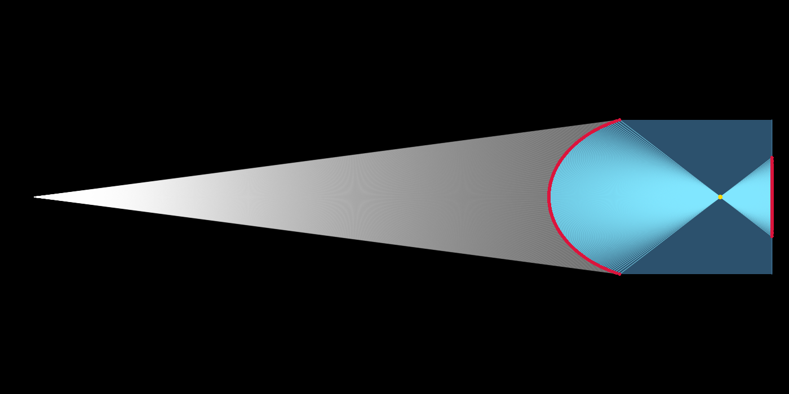

Comparada con una esfera de la **misma curvatura de vértice**, entre los
**mismos conjugados** y a la misma apertura:

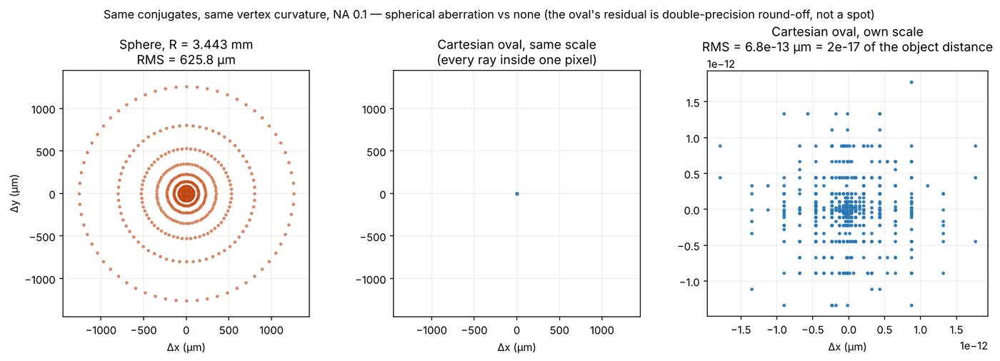

La esfera deja 625,8 µm RMS de aberración esférica. El óvalo deja
6,8e-13 µm, que es el suelo de la precisión de doble: 2e-17 de la distancia
objeto. El paquete *verifica* el estigmatismo, y los ejemplos imprimen el
número.

En 3-D, el mismo óvalo revuelto y recorrido por un haz denso:

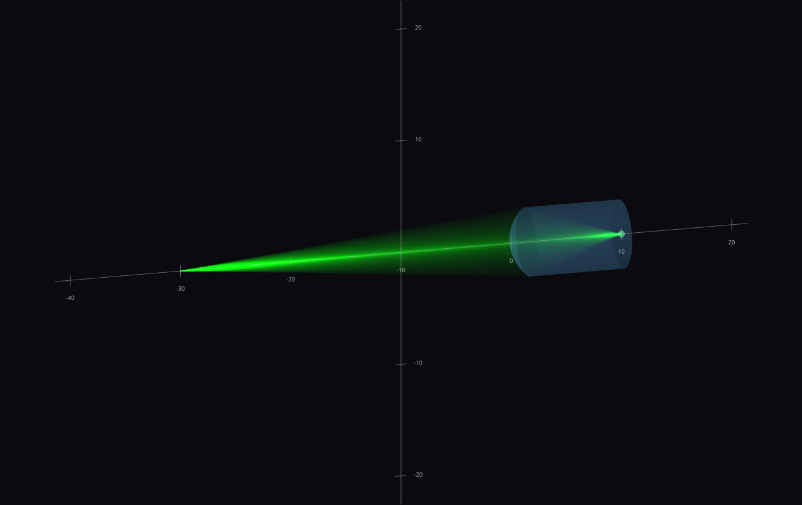

## Lentes estigmáticas y aplanatismo

Un óvalo de Descartes es estigmático para *un* par de conjugados. Encadenar
N de ellos, de modo que la imagen de cada superficie sea el objeto de la
siguiente, produce una **lente ovoide estigmática** (SOL, *stigmatic ovoid
lens*): libre de aberración esférica a cualquier apertura, sin aproximación
paraxial en ninguna parte. Para conjugados extremos fijos, las conjugadas
intermedias quedan libres — toda elección es estigmática, y esa libertad es
la moneda con que se compra la segunda propiedad: el **aplanatismo**, la
condición del seno de Abbe, que elimina también el coma.

La teoría es la de Silva-Lora & Torres: por cada superficie, la normal en el
punto de impacto cruza el eje a una distancia `V_k C_k` del vértice, con
forma cerrada en los parámetros GOTS (su Ec. 24); el cociente de senos
factoriza sobre las superficies como `sin u₀ / sin u_N = (n_N/n₀) · g_t · M`,
y el sistema es aplanático exactamente cuando el mapa `M ≡ 1` para todo rayo
(Ec. 25). El paquete implementa las dos rutas — la forma cerrada evaluada en
los puntos de impacto trazados, y el cociente de senos medido sobre los
rayos exactos — y los tests exigen que coincidan a 1e-9 por rayo.

```python
from raytracer.families import StigmaticTrain
from raytracer.analysis import aplanatism_report, aplanatic_image_surface
from raytracer.optimize import optimize_aplanat

# La familia: tres vidrios cementados, 4 superficies de Descartes,
# conjugados -100 -> +90. Estigmática para cualquier (d1, d2, d3).
train = StigmaticTrain(
    media=(1.0, 1.517122, 1.670591, 1.851280, 1.0),   # aire y tres vidrios
    vertices=(0.0, 15.0, 25.0, 35.0),
    conjugates=(-100.0, -150.0, -600.0, 450.0, 90.0),
    semidiameter=10.0,
)
print(aplanatism_report(train, na_object_sine=0.195).map_rms)   # 3.2e-03

fit = optimize_aplanat(train, na_object_sine=0.195, samples=21,
                       bounds=(-3000, 3000), diff_step=1e-4,
                       xtol=1e-14, ftol=1e-14, gtol=1e-14)
print(fit.after.map_rms)                                        # 3.1e-06
```

Hay un aplanático **exacto** con solo dos superficies: el singlete Omega
simétrico (`StigmaticTrain.symmetric_singlet`), con la conjugada intermedia
en el centro de la lente. Por simetría especular cada rayo sale con el seno
con que entró, y `M = 1` queda en 2e-16 — precisión de máquina, verificado
por trazado. Su firma se ve en el desenfoque fuera de eje: el blur del
singlete estigmático crece *lineal* con el campo (coma), el del aplanático
crece *cuadrático* (el coma se fue, queda astigmatismo). Medido: cocientes
2.00 y 4.00 exactos al duplicar el campo.

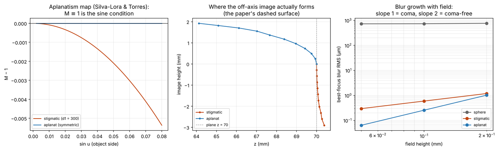

El panel central muestra **la superficie donde se forma la imagen
aplanática** — la línea discontinua de las figuras del artículo —
localizada trazando un cono desde cada punto objeto desplazado y reduciendo
el haz emergente a su punto de mínimos cuadrados (`aplanatic_image_surface`).
El aplanatismo no la aplana: el singlete simétrico es aplanático exacto con
7,8 mm de sagita en 3 mm de campo. Aplanarla es una restricción adicional
que el optimizador acepta como término de campo plano (`flat_field_weight`),
y el experimento del ejemplo la recorre por número de superficies:

| N superficies | (M−1)_RMS | sagita máx (campo 3 mm) |
|---|---|---|
| 2 (aplanático exacto, sin libertad) | 2.1e-16 | 7.77 mm |
| 4 (cementado, peso de campo plano) | 3.6e-04 | 0.0000 mm |
| 6 (triplete en aire, peso de campo plano) | 7.9e-06 | 0.0001 mm |

Con 3 grados de libertad (N=4) se compra aplanatismo *o* campo plano; con 5
(N=6) alcanza para los dos: el mínimo en superficies que logra **aplanatismo
en un plano**, bajo las tolerancias del ejemplo, es 6. Las conjugadas
intermedias infinitas declaran espacios colimados y son estructurales — el
optimizador no las toca — y una superficie con sus dos conjugadas vecinas en
infinito degenera exactamente en un **plano**: así entra una cara plana,
fabricable, en un tren exactamente estigmático.

La construcción en dos superficies sigue la abstracción Ω (`OmegaLens`) del
[generador de STL de superficies cartesianas](https://github.com/blancusjh/cartesian-surfaces-stl-generator)
del autor; aquí la misma lente es una familia (`StigmaticTrain`) cuyo
miembro `train.system()` son lentes reales colocadas sobre el eje, en
contacto donde dos vidrios se tocan, con un sensor en la conjugada imagen.

**Fuentes.** A. Silva-Lora y R. Torres, *Aplanatism in stigmatic optical
systems*, J. Opt. Soc. Am. A 37 (2020); *Superconical aplanatic ovoid
singlet lenses*, J. Opt. Soc. Am. A 37, 1155–1165 (2020); *Explicit
Cartesian oval as a superconic surface for stigmatic imaging optical systems
with real or virtual source or image*, Proc. R. Soc. A 476, 20190894 (2020).
La parametrización GOTS de `raytracer.geometry.surfaces.cartesian` transcribe la
del segundo artículo; `raytracer.analysis.aberrations.aplanatism` implementa
las Ecs. (24)–(31) del primero.

## La ontología del paquete

Cada paquete responde una sola pregunta, y las dependencias forman una cadena
estrictamente descendente: todo import a nivel de módulo apunta a un paquete
anterior.

```
geometry → materials → coatings → interfaces → elements → system → sources
         → tracing → families → io → analysis → optimize → viz
```

| paquete | pregunta | líneas |
|---|---|---|
| **`geometry`** | ¿dónde está y qué forma tiene? — `Rotation`, `Pose`, superficies, aperturas, sólidos, intersección. Nada de óptica | 1969 |
| **`materials`** | ¿qué llena el espacio? — índice constante, Abbe, Cauchy, Sellmeier, catálogo | 250 |
| **`coatings`** | ¿cuánta luz refleja y transmite una frontera? | 155 |
| **`interfaces`** | una superficie como frontera óptica, y las leyes de reflexión y refracción | 96 |
| **`elements`** | ¿de qué cosas físicas está hecho un instrumento? — `Lens`, `Mirror`, `BeamSplitter`, `Prism`, `Stop`, `Sensor` | 382 |
| **`system`** | ¿cómo están dispuestas y qué se sigue de ello? — `OpticalSystem`, `Assembly`, fronteras con sus medios, camino secuencial, tablas | 877 |
| **`sources`** | ¿dónde empieza la luz? | 236 |
| **`tracing`** | ¿cómo llega la luz de aquí a allá? — secuencial, no secuencial, paraxial, pupilas | 1113 |
| **`families`** | ¿qué sistemas genera una familia de diseño? — `StigmaticTrain` | 363 |
| **`io`** | ¿cómo se guarda un diseño? | 430 |
| **`analysis`** | ¿qué se mide? — `imaging` mira la imagen, `aberrations` el error de rayo y de frente de onda | 2274 |
| **`optimize`** | ¿qué es mejor? — restricciones enchufables sobre familias exactas | 553 |
| **`viz`** | ¿cómo se muestra? — matplotlib y OpenGL HDR, 2-D como corte meridional del modelo 3-D | 3483 |

`tests/test_architecture.py` lee el AST de cada módulo y comprueba la
cadena en cada `pytest`. Comprueba además dos reglas más finas: un elemento
no importa nunca el sistema ni los motores, y el sistema no importa nunca
un motor ni un formato de archivo.

### Cuatro decisiones que explican el resto

**Lo declarado y lo deducido no se mezclan.** Un objeto guarda lo que se
dijo de él. Los medios a cada lado de una frontera, el camino de un sistema
coaxial, las posiciones de los vértices y el contacto entre dos lentes se
calculan a partir de los elementos. Nunca se almacenan como estado propio.

**El hardware no es el uso.** El sistema no sabe de longitudes de onda ni
de planos objeto. Esos son hechos del uso, y los lleva el trazador
(`SequentialTracer(system, wavelength_um=..., object_z=...)`). El mismo
sistema se traza a cualquier longitud de onda sin reconstruirlo.

**Todo es un valor.** Superficies, interfaces, elementos, ensamblajes y
sistemas son inmutables y se comparan por sus parámetros. `rotated`,
`translated`, `placed` y `replace` devuelven valores nuevos. Nada en el
paquete muta un sistema.

**Un solo modelo para los dos motores.** El trazador secuencial sigue el
camino del sistema. El no secuencial recorre las mismas fronteras, con los
mismos medios y los mismos recubrimientos, sin orden. No hay un "mundo
2-D": un dibujo plano es el corte meridional del modelo 3-D, y una fuente
con `fan="y"` emite el abanico meridional.

## Instalación

```bash
pip install -e .          # numpy, scipy, matplotlib
pip install -e ".[gl]"    # + vispy y un backend de ventana, para el visor OpenGL
```

## Ejemplos

```bash
python -m examples.lithography.duv_objective_3d --spectrum   # la imagen de arriba
python -m examples.lithography.duv_objective_2d              # el mismo objetivo, HDR 2-D
python -m examples.stigmatic_surfaces.ellipse_mirror
python -m examples.stigmatic_surfaces.cartesian_oval_refractor_2d
python -m examples.stigmatic_surfaces.cartesian_oval_refractor_3d --beam
python -m examples.stigmatic_surfaces.aplanatic_sol            # esfera vs estigmática vs aplanática
python -m examples.telescopes.keplerian                      # y galilean, newtonian
python -m examples.imaging.single_lens_relay                 # matplotlib y OpenGL
python -m examples.imaging.interactive_doublet               # arrastra fuente/lente/pantalla
python -m examples.imaging.geometric_and_diffractive_imaging
```

Todos aceptan `--save salida.png` para renderizar sin abrir ventana;
`docs/render_images.py` regenera con eso las imágenes de este README.

Cada ejemplo verifica su propia afirmación e imprime el número. El espejo
elíptico mide la distancia de cada rayo reflejado al foco lejano
(5,9e-13 µm RMS); el newtoniano comprueba que el plegado exacto a 90°
conserva el foco (1,9e-15); los telescopios *resuelven* la separación que
hace infinita la focal efectiva en el sistema real de espesor finito, y
luego confirman por trazado que dos rayos paralelos salen paralelos.

| | |
|---|---|
| 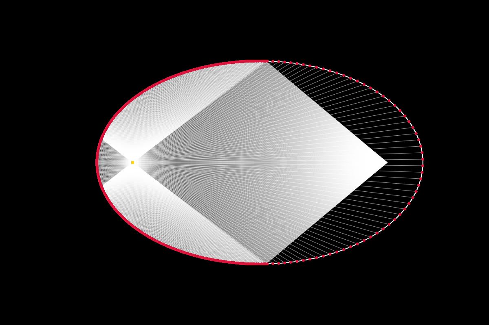 | 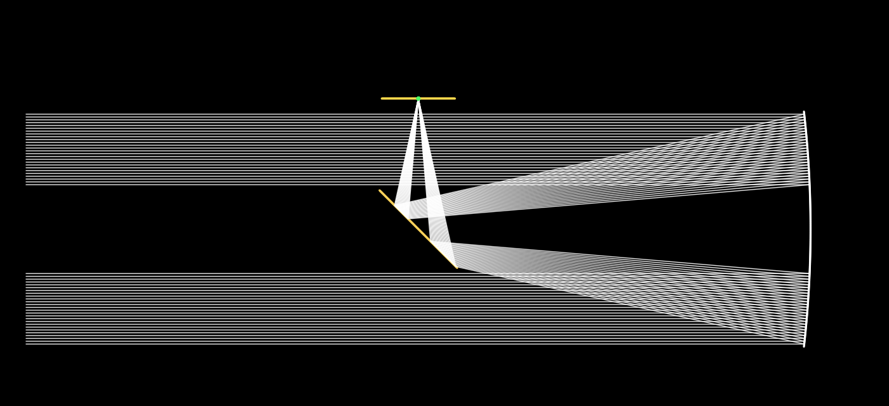 |
| **Espejo elíptico** — todo rayo que sale de un foco pasa por el otro. | **Newtoniano** — primario parabólico, secundario plano a 45°, haz anular con obstrucción central. |
| 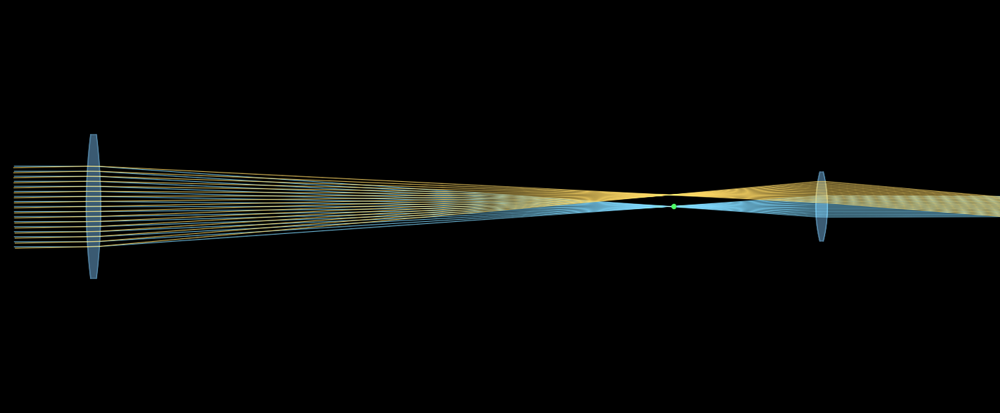 | 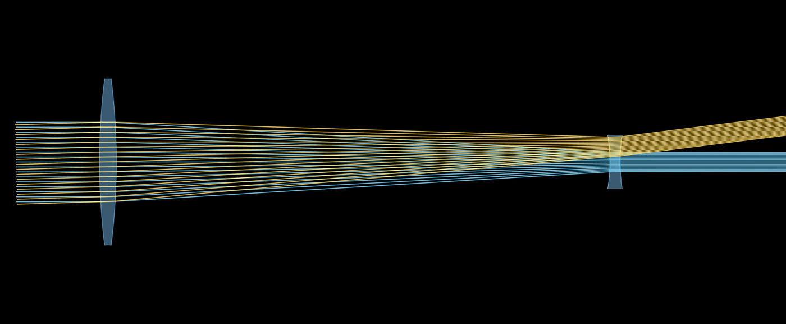 |
| **Kepleriano** — imagen intermedia real (punto verde). **−3,989×**, invertida. | **Galileano** — ocular negativo, tubo corto. **+4,069×**, derecha. |

Los notebooks en `examples/notebooks/` reproducen dos objetivos de patente
completos: `us7557996_objective.ipynb` (el DUV de inmersión, réplica dígito a
dígito del análisis de referencia) y `euv_six_mirror.ipynb` (objetivo EUV de
seis espejos, US 7,151,592, NA 0.22, λ=13.4 nm — con refit de asféricas por
mínimos cuadrados, frente de onda por eikonal e imagen de Abbe). Los dos
incluyen su malla de distorsión, la del EUV centrada en su campo anular de
trabajo, a 120 mm del eje. `stigmatism_and_aplanatism.ipynb` recorre completa
la sección de aplanatismo: los tres singletes, el mapa `M`, la superficie
imagen aplanática, la optimización del triplete cementado, las mallas de
distorsión de los tres SOL (7,2 % → 0,085 % → 0,002 %), abanicos de rayos,
métricas de campo y la tabla de Seidel que separa esfera, estigmático y
aplanático. `building_optical_systems.ipynb` construye cuatro sistemas
potentes de solo lentes y aire con vidrios reales del catálogo Sellmeier —
objetivo de telescopio acromático de 2 lentes (blur 1,5 µm contra 5,5 µm de
Airy), microscopio 20×/NA 0.25 de 3 lentes con campo plano y 0,1 % de
distorsión, ultra-gran-angular de objeto virtual (estigmático exacto; campo físico
±43°, acotado por el cruce de caras de sus dos lentes)
y proyector de 4 lentes — cada uno optimizado con las restricciones
enchufables (`Aplanatism`, `Distortion`, `FlatImageSurface`,
`TargetMagnification`, `AxialColor`), y cierra con el microscopio
imprimible: tres lentes de resina Formlabs Clear V4, con su dispersión
medida leída de `data/materials/formlabs_resins.csv` y su color axial declarado
(la búsqueda multiarranque vive en `docs/design_systems.py`).

## Tests

```bash
pytest -m "not gpu"                       # 393 tests
xvfb-run -a pytest                        # 397, incluidos los de contexto OpenGL
```

Las verdades de referencia son analíticas donde existen: conjugados de
parábola y elipsoide a precisión de máquina, magnificación paraxial del
objetivo DUV (+0.2500000135), NA de imagen 1.1977, RMS de Zernike (0.5089 nm
tras quitar tilt y desenfoque), primer cero de Airy, colapso de contraste en
el límite de coherencia parcial, y linealidad aditiva del framebuffer HDR.
El impacto de Newton sobre el óvalo de Descartes se contrasta con su
parametrización cerrada, y la intersección cerrada de las cónicas con la de
Newton. Un sistema plegado con doble paso iguala a su gemelo desplegado a
1e-12. La energía se conserva en cada división, con o sin recubrimiento, y
una placa reproduce la serie incoherente de Fresnel `(1−R)/(1+R)` a 1e-10. La Ec. (24) del artículo de
aplanatismo se contrasta con la construcción geométrica de la normal, y el
mapa `M` con el cociente de senos de los rayos exactos, a 1e-9 por rayo; el
singlete simétrico ancla el caso `M ≡ 1` a precisión de máquina. La cadena
de dependencias entre paquetes se comprueba leyendo el AST de cada módulo.

## Estructura del repositorio

```
raytracer/     el paquete
data/          datos puros, organizados por naturaleza:
  materials/         catálogos de materiales (formlabs_resins.csv)
  optical_systems/   prescripciones y diseños por clase de sistema:
    lithography/ photographic/ elements/          (prescripciones CSV)
    telescopes/ microscopes/ projectors/ ultrawide/  (trenes JSON)
examples/      demos ejecutables por categoría + notebooks de réplica de patentes
docs/          imágenes del README, el script que las regenera y las búsquedas de diseño
reference/     notebooks y módulo de referencia originales
tests/         verdades analíticas + regresiones de sistema completo
```
